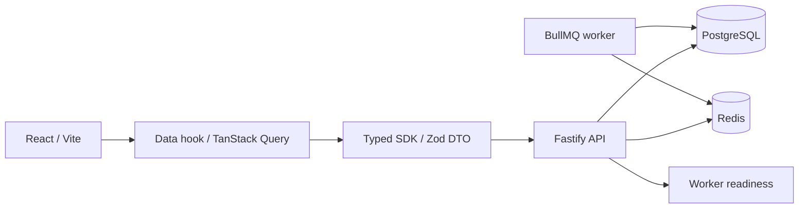

# Architecture

## Foundation (Phase 0, retained)

API remains a modular monolith; Phase 1.1 adds the identity module described below. The independent worker retains `synthetic.ping` and adds durable identity mail through local Mailpit. There is no arbitrary job enqueue HTTP endpoint, external mail sender or payment adapter.

Workspace packages resolve TypeScript source under the `development` condition, and compiled JavaScript under the default condition. Build outputs are distributed to each package's `dist`, preserving pnpm's per-package dependency resolution. Server production entry points are `apps/api/dist/main.js` and `apps/worker/dist/main.js`. No runtime tsx is needed for built apps.

API returns a true 503 if PostgreSQL migrations/role checks, Redis PING or worker readiness fail. Liveness reports process availability independently. Worker readiness checks its own role, migration state, Redis and queue startup/running state. A ready response is a point-in-time probe, not an uptime guarantee. Requests have server-generated UUIDs. Logs omit headers, query strings, request bodies, credentials and raw exception text.

## Module responsibilities and dependency direction

The all-phase requirements live in [AGENTS.md](../AGENTS.md#maintainability--applies-to-every-phase). Organize new features by business domain within the modular monolith. Transport adapters call an application service; the service orchestrates policy/domain rules and a scoped repository within an explicit transaction. Domain rules do not import HTTP, UI or worker infrastructure. Repository implementations may depend on `packages/db`, but cannot silently create authorization or accept arbitrary client-supplied scope. Cross-domain calls use the owning module's explicit service/contract, not its private tables or handlers; avoid cycles.

| Boundary | Responsibility | Must not become |
|---|---|---|
| HTTP handler | parse/validate input, call service, map DTO/error | complete business workflow or raw table response |
| Application/domain service | authorization, invariants, orchestration and transaction ownership | HTTP/UI-dependent logic or a duplicate worker policy |
| Scoped repository | queries/writes under established scope and DB constraints | generic CRUD bypass, UI/HTTP layer or implicit global access |
| Worker adapter | validate job reference, load trusted context, call the same service, report outcome | second implementation of business rules |

Pure domain rules can be tested without starting HTTP or queues. Transaction-dependent invariants still need real PostgreSQL tests. Shared abstractions must address observed duplication or a stable boundary; no universal repository, workflow engine or empty domain package is required. The current health-only handler and pure synthetic processor do not justify manufacturing business service layers.

### Entry points for handoff

| Work | Start here |
|---|---|
| API composition / route behavior | `apps/api/src/main.ts` / `apps/api/src/app.ts` |
| Worker lifecycle / processor | `apps/worker/src/main.ts` / `apps/worker/src/worker.ts` |
| Transaction scope / migrations | `packages/db/src/index.ts` / `packages/db/src/migrate.ts` and `packages/db/migrations/` |
| Environment validation | `packages/config/src/index.ts`; setup/Compose values must agree |
| Contract → UI path | [UI_CONTRACT.md](UI_CONTRACT.md), [DATA_CONTRACT.md](DATA_CONTRACT.md) |
| Tests / failures | [TESTING.md](TESTING.md#handoff-and-common-failures), [OPERATIONS.md](OPERATIONS.md) |

Keep names tied to business intent, comments focused on reasons/constraints, and changes scoped to the task. Document important dependency decisions and their costs in `docs/adr/`. The focused Phase 0 findings and scheduled improvements live only in [ROADMAP.md](ROADMAP.md#phase-0-maintainability-review--2026-10-15).

## Isolation boundary

PostgreSQL owns durable state. Migration login `confsys_migrator` owns schemas; `confsys_app` and `confsys_worker` are distinct NOSUPERUSER/NOBYPASSRLS logins, not table owners and not members of elevated roles. Runtime startup probes reject unsafe roles. Migration 0001 installs the infrastructure ledger/grants; additive 0002 installs local identity/session/token/audit/notification tables. No seed user is installed.

Each deployment fixes its own database/Redis connections at startup. Host/header/resource IDs never select a database. Email uniqueness is local to that DB, and worker notification eligibility is a reviewed local projection. There is no default organization, membership resolver or global registry.

The unused Phase 0 `withTenant` helper and tenant fixture were retired in 1.1b. `withIdentityTransaction` still owns one pooled connection and commit/rollback; failed rollback destroys it. Actual-role grant, rollback, pool-reuse and constraint tests remain. Resource authorization and suitable resource-level RLS belong to future local business modules; no production RLS policy was disabled.

## Later business modules; not implemented

Phase 1.1 implements identity/session and its minimal audit/outbox. Phase 1.2 adds local account access control below. Later units introduce resource permissions, settings versions and private file metadata. Domain services/policies will be shared with worker; controllers only validate/map requests. No empty domain package was created because there are no business state machines yet.

Outbox: business state + event commit atomically in PostgreSQL. Dispatcher retries delivery using stable event IDs; handlers re-load trusted scope, re-check current policy, record attempts and deduplicate business outcomes. At-least-once processing does not guarantee exactly-once SMTP/payment effects. See ADR for interface conventions. This was the Phase 0 convention; Phase 1.1 implements identity-only notification records as described below.

Storage will be private and authorized; no upload endpoint, public upload directory or provider exists. Public content requires explicit published DTO projections, not table rows. Redis queue and cache share a single noeviction development instance only; production requires separate instances. Redis logical DBs used in tests do not provide production resource isolation.

## Phase 1.1 entry points and boundaries

- `apps/api/src/auth/routes.ts`: CSRF/Origin, schema parsing, safe cookies and DTO responses; no SMTP or tenant-resolution logic.
- `auth/service.ts`: user-state policy, credential-version race protection, token/session lifecycle and transaction ownership. `auth/repository.ts`: explicit local identity queries; no generic authorization fallback. Password and rate-limit helpers own their specific bounded security rules.
- `packages/notifications/src/index.ts`: transaction-bound notification writer. `secrets.ts`: AES-GCM delivery envelope. The `/worker` export owns DB claim/lease/eligibility, BullMQ dispatch and capture SMTP; importing the writer in API does not load the worker/provider path.
- `packages/db/migrations/0002_identity.sql`: constraints, dedicated role grants and worker-only eligibility projection. No worker access to `users`, `sessions` or `auth_tokens`; no RLS bypass introduced.
- `packages/contracts/src/auth.ts` → `packages/sdk/src/auth.ts` → `apps/web/src/features/auth/hooks/use-auth.ts` → pure `components/auth-screen.tsx`.
- `packages/config`: API/worker/migration loaders strip other process settings. Compose has distinct environments; `scripts/run-process.ts` starts host/E2E children with only validated process config. `.env` is read by the local launcher, never passed wholesale to child services.

Business transactions use PostgreSQL. Redis is needed only for public auth abuse protection and queue scheduling; session reads/logout remain DB-only. Persistent notification rows reconstruct lost queue jobs. `notification_eligibility` is an explicitly local identity projection, not authority to access arbitrary business resources. No membership resolver is needed. Complete security decisions/tradeoffs: [ADR 0002](adr/0002-identity-session-mail.md).

Migration `0003_identity_grants.sql` narrows runtime UPDATE privileges to required lifecycle/delivery columns and limits the worker eligibility projection to pending/processing notifications. It is a separate forward migration because 0002 had already been exercised locally; 0001/0002 are not rewritten. Actual-role regression rejects recipient/token reassignment, email edits and expiration/hash rewrites outside the implemented services.

## Runtime instance configuration (1.1b)

`packages/config` validates server-only connection/secrets and canonical `PUBLIC_APP_ORIGIN`, plus `CONFERENCE_NAME`. API `instance.ts` exposes only `{conferenceName}`; contracts → SDK `getInstance` → `useInstance` → props-only UI. API and capture worker receive the same display setting; this describes the 1.1b baseline; Phase 1.3 authority below supersedes runtime-only branding. There is no build-time VITE identity/config value. Web ingress validates Host and forwards canonical Host to API, never trusts forwarded host/IP. Health endpoints permit internal probes; all other API routes require canonical Host.

One image contains Web/API/worker builds and can run multiple independent Compose projects. Compose's project name is sufficient operational identification; no redundant INSTANCE_ID field is added to account rows. Project-specific networks have no shared external network; only loopback development ports are published. No file adapter/metadata/storage volume exists yet: private upload/download is explicitly unimplemented.

## Phase 1.2 entry points and responsibility boundaries

`access/routes.ts` validates transport and Origin/CSRF; `access/service.ts` owns session authorization, target eligibility, recent proof, transactions and last-admin invariant; `access/policy.ts` owns the fixed mapping and pure policies; `access/repository.ts` owns bindings/control/audit projections and SQL. `auth/session.ts` is the shared trusted session resolver. Identity and access services intentionally share the existing user lock/credential/session/token persistence primitives in `auth/repository.ts`; neither duplicates password logic or creates a second epoch. Auth account projection uses the same roles reader/mapping. These are parts of the local identity domain, not separate services with circular service calls.

`access/bootstrap.ts` is an operator-only application entry point, imported by `scripts/bootstrap-admin.ts`, never registered by HTTP or worker. Its validated config contains only migration connection/display/origin; no new environment variable or bootstrap password exists. It checks the operator DB role, uses the same lock/grant/audit primitives, and stores the one-time marker atomically. The worker has no access to new role/marker/audit reads; disabled notification eligibility remains its existing narrow view.

Readiness now requires migration 0004. Existing tables/migrations are not rewritten. New session proof is nullable for preserved old sessions; current login records true password verification time. See ADR 0004 for lock order, version fencing, failure/roll-forward semantics and pagination tradeoff. No extra RBAC framework, empty package, Redis permission cache or shared-instance identity.

Browser flow: contracts/access → SDK (`createAuthClient` retains the single credential/CSRF transport) → `features/access/hooks/use-access` → props-only `access-screen`. Account links expose the directory only through server capabilities. Queries use private keys, AbortSignal and cancellation/removal on session expiry; in-flight detail/mutation callbacks are aborted and gated. Login/logout fully navigate, discarding the old query client. No token/browser persistence in components.

## Phase 1.3 site entry points

`site/routes.ts` validates transport/CSRF and calls `site/service.ts`; the service owns exact versions, current actor/proof, transaction boundaries and validation; `site/repository.ts` owns narrow SQL/projections/audit. `site/branding.ts::effectivePublicSite` is the single official identity resolver, also called inside auth outbox transactions. Notifications store a creation-time name; the worker consumes that snapshot without site-table access. No circular service calls or new dependencies.

`site/public-routes.ts` loads official data → `apps/web/dist/server/entry-server.js` → pure `PublicSiteContent`; `/admin/site` hook loads protected saved version → the same component. No renderer DB/network/config/authorization. `packages/contracts/site` owns finite document/DTO schemas and semantic checks; SDK owns all browser requests, site hook owns query/mutation/cancellation/form state, components accept values/callbacks. AST permits only type-only DTO imports in presentation and narrowly allowlists the server entry. API build loads an absolute workspace artifact path; production image includes it.

Ingress order: known SPA auth/access/admin/system routes → static `/assets/*` → public/API proxy to Fastify (unknown public paths return 404). Vite dev proxy uses equivalent exclusions. `/system/status` preserves the former root diagnostics; `/` is the actual public site. No service worker. Dynamic responses are no-store; hash assets immutable. Readiness requires migration 0005. See ADR 0005 and TESTING for lock/version/failure evidence.
