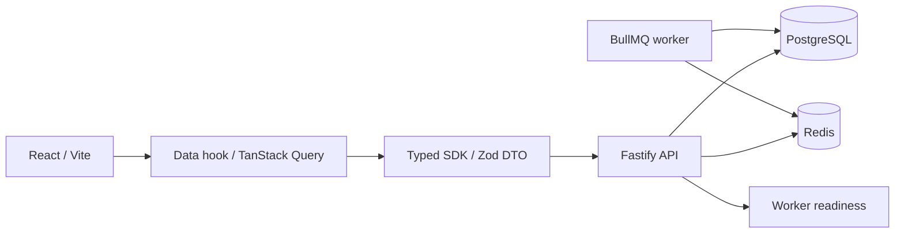

# Architecture

## Implemented in Phase 0

API is a modular monolith, with only infrastructure routes in this phase. Worker is a separate process; it supports only `synthetic.ping` with a UUID nonce and no external effects. There is no job enqueue HTTP endpoint. Mailpit is a local capture service; no production sender or payment adapter is present.

Workspace packages resolve TypeScript source under the `development` condition, and compiled JavaScript under the default condition. Build outputs are distributed to each package's `dist`, preserving pnpm's per-package dependency resolution. Server production entry points are `apps/api/dist/main.js` and `apps/worker/dist/main.js`. No runtime tsx is needed for built apps.

API returns a true 503 if PostgreSQL migrations/role checks, Redis PING or worker readiness fail. Liveness reports process availability independently. Worker readiness checks its own role, migration state, Redis and queue startup/running state. A ready response is a point-in-time probe, not an uptime guarantee. Requests have server-generated UUIDs. Logs omit headers, query strings, request bodies, credentials and raw exception text.

## Module responsibilities and dependency direction

The all-phase requirements live in [AGENTS.md](../AGENTS.md#maintainability--applies-to-every-phase). Organize new features by business domain within the modular monolith. Transport adapters call an application service; the service orchestrates policy/domain rules and a scoped repository within an explicit transaction. Domain rules do not import HTTP, UI or worker infrastructure. Repository implementations may depend on `packages/db`, but cannot silently create authorization or accept arbitrary client-supplied scope. Cross-domain calls use the owning module's explicit service/contract, not its private tables or handlers; avoid cycles.

| Boundary | Responsibility | Must not become |
|---|---|---|
| HTTP handler | parse/validate input, call service, map DTO/error | complete business workflow or raw table response |
| Application/domain service | authorization, invariants, orchestration and transaction ownership | HTTP/UI-dependent logic or a duplicate worker policy |
| Scoped repository | queries/writes under established scope and DB constraints | generic CRUD bypass, UI/HTTP layer or implicit global access |
| Worker adapter | validate job reference, load trusted context, call the same service, report outcome | second implementation of business rules |

Pure domain rules can be tested without starting HTTP or queues. Transaction-dependent invariants still need real PostgreSQL tests. Shared abstractions must address observed duplication or a stable boundary; no universal repository, workflow engine or empty domain package is required. The current health-only handler and pure synthetic processor do not justify manufacturing business service layers.

### Entry points for handoff

| Work | Start here |
|---|---|
| API composition / route behavior | `apps/api/src/main.ts` / `apps/api/src/app.ts` |
| Worker lifecycle / processor | `apps/worker/src/main.ts` / `apps/worker/src/worker.ts` |
| Transaction scope / migrations | `packages/db/src/index.ts` / `packages/db/src/migrate.ts` and `packages/db/migrations/` |
| Environment validation | `packages/config/src/index.ts`; setup/Compose values must agree |
| Contract → UI path | [UI_CONTRACT.md](UI_CONTRACT.md), [DATA_CONTRACT.md](DATA_CONTRACT.md) |
| Tests / failures | [TESTING.md](TESTING.md#handoff-and-common-failures), [OPERATIONS.md](OPERATIONS.md) |

Keep names tied to business intent, comments focused on reasons/constraints, and changes scoped to the task. Document important dependency decisions and their costs in `docs/adr/`. The focused Phase 0 findings and scheduled improvements live only in [ROADMAP.md](ROADMAP.md#phase-0-maintainability-review--2026-10-15).

## Isolation boundary

PostgreSQL owns durable state. Migration login `confsys_migrator` owns schemas; `confsys_app` and `confsys_worker` are distinct NOSUPERUSER/NOBYPASSRLS logins, not table owners and not members of elevated roles. Runtime startup probes reject unsafe roles. Initial migration installs only a checksum ledger and its grants; no product entities or seed users exist.

`withTenant` acquires one pooled connection, begins a transaction, validates UUID scope, sets both context settings with `set_config(..., true)`, executes a Drizzle/client callback on that connection, then commits or rolls back. Failed rollback destroys the connection. Scope cannot be omitted. Integration tests also directly query without context to prove RLS denial. Schema policies use both organization and conference keys, FORCE RLS and WITH CHECK. Composite keys prevent cross-scope references.

**This helper does not authenticate anybody.** Future HTTP services must resolve scope from authenticated memberships and resource ownership, then invoke it. Never map arbitrary request headers/body IDs directly into this helper. RLS is defense in depth against forgotten filters; it does not defeat a compromised application credential that can execute arbitrary SQL and set its own context.

## Planned; not implemented

Phase 1 introduces identity/session, organization/conference memberships, settings versions, audit, transactional outbox and private file metadata. Domain services/policies will be shared with worker; controllers only validate/map requests. No empty domain package was created because there are no business state machines yet.

Outbox: business state + event commit atomically in PostgreSQL. Dispatcher retries delivery using stable event IDs; handlers re-load trusted scope, re-check current policy, record attempts and deduplicate business outcomes. At-least-once processing does not guarantee exactly-once SMTP/payment effects. See ADR for interface conventions. No notification/outbox tables are claimed in Phase 0.

Storage will be private and authorized; no upload endpoint, public upload directory or provider exists. Public content requires explicit published DTO projections, not table rows. Redis queue and cache share a single noeviction development instance only; production requires separate instances. Redis logical DBs used in tests do not provide production resource isolation.
